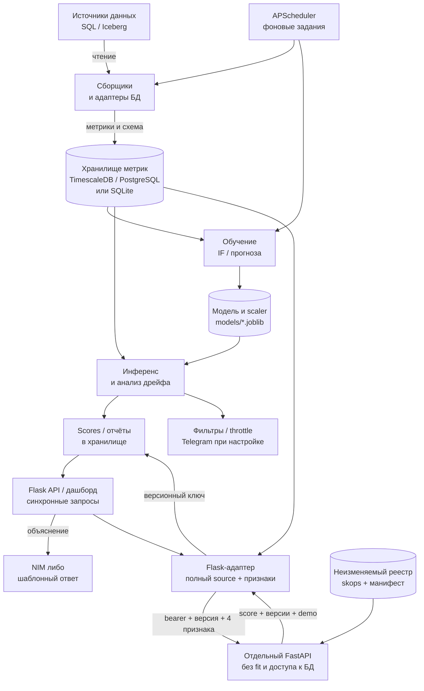

# DB Monitoring — актуальная архитектура

Обновлено 25.10.2026 по реализации #12; исходная сверка #3 выполнена 13.10.2026 по [`59c54fa`](https://github.com/aleksandr-novikov/ai-integration-development/tree/59c54fa3f5de502126cbbbf0617688e1b9ead4eb). В02, слайд 51: схема, компоненты, потоки и стек, около двух страниц. [Описание кейса](course/CASE.md) задаёт пользователя и измеримые цели.

## Компоненты и поток данных

Специалист по качеству данных получает сигнал об аномалии агрегированных метрик и проверяет его вручную. Система не исправляет исходные данные. Flask, сборщики и планировщик остаются модульным монолитом. Для выбранных источников добавлен отдельный FastAPI-инференс без доступа к истории и обучения на запросе; legacy-анализ остаётся в приложении.

Схема показывает legacy и новый путь сохранённых результатов. Прогноз вызывается из Flask API синхронно. FastAPI — отдельный процесс; его импорт не запускает Flask и APScheduler. Для выбранных источников периодический скоринг и дашборд используют тот же HTTP-сервис и явно выбранную версию.

**Сбор и хранение.** `MetricsCollector` читает число строк, размер, NULL-статистику и распределения; `SchemaCollector` фиксирует схему. `collect_for_connection` выбирает адаптер и настройки подключения, записывает данные с `project_id`. Это периодический **micro-batch**, а не непрерывный поток событий: интервал подключения 5–1440 минут, legacy-сбор по умолчанию раз в 15 минут. Полный сбор SQL-статистик может сканировать таблицу; ограничения нагрузки и режимы `sample`/`approx` зависят от адаптера. Iceberg использует метаданные snapshot/manifest.

Источник `DATABASE_URL` и хранилище `MONITOR_DB_URL` разделены. Compose запускает PostgreSQL-источник и TimescaleDB-хранилище с отдельными volumes. В TimescaleDB таблица `metrics` становится hypertable; поддержан обычный PostgreSQL без расширения. SQLite остаётся локальным режимом и используется в тестах. Хранилище содержит также пользователей, проекты, подключения, результаты ML и уведомления. Распределения могут включать значения колонок: считать всё содержимое исключительно обезличенными счётчиками нельзя.

**Обучение и инференс.** Isolation Forest получает `row_count`, среднюю долю NULL и две разности соседних согласованных наблюдений; `StandardScaler` обучается вместе с моделью. Нужны минимум 200 строк признаков. Обучение пишет модель и scaler в `models/`, скоринг читает их и сохраняет оценки. Планировщик переобучает прогноз в 03:00, IF в 04:00; часовой поиск change-point — отдельное задание. Часовой пояс берётся из окружения APScheduler, UTC явно не закреплён. Это независимые задания, без гарантии завершения одного перед другим.

В legacy `score_table` обучает отсутствующую модель, `forecast` переобучает устаревшую в HTTP-запросе. Новый сервис принимает признаки от адаптера, проверяет полный source, выбранный манифест/scaler, возвращает сырой score и версии без fit. Общая чистая функция признаков используется обучением и адаптером. Ночное задание для переведённых источников может создавать кандидатов, но не переключает выбранную версию. Учебные [MLflow-эксперименты](course/experiments/README.md) **не публикуют автоматически** модель. Старые scores отмечены `legacy-unknown`, новые хранятся с полным источником и парой версий; режим demo также сохраняется. [Реестр #5](course/models/README.md) и [запуск #12](course/inference/README.md).

**Синхронные запросы и уведомления.** Flask обслуживает API и страницы, Plotly отображает историю. Вспомогательные `/api/tables` и `/api/schema/<table>` обращаются к адаптеру источника, поэтому API не полностью изолирован от БД. Telegram использует настройки проекта, фильтры качества и ограничение частоты. LLM только формулирует гипотезу по контексту метрик; при отсутствии ключа или сбое NIM работает шаблонный ответ. Решение об аномалии принимает classical ML, причина требует проверки человеком.

## Стек, изоляция и актуальные ограничения

Python, Flask, SQLAlchemy и APScheduler позволяют переиспользовать рабочие UI, доступ к БД и фоновые задания. Scikit-learn подходит для числовых признаков без готовых обучающих меток; Prophet/линейная модель — для прогноза, ruptures и PSI/KS — для смены режима и дрейфа. Jinja2/Plotly сохраняют интерфейс, MLflow фиксирует эксперименты. FastAPI реализует отдельную проверяемую границу инференса; [ADR-001](adr/001-flask-and-inference-service.md) объясняет выбор.

Flask-Login, CSRF, роли участников и текущий проект задают доступ. Новые метрики, scores, контекст и кэш объяснений учитывают проект, подключение, схему и таблицу. `/api/explain` проверяет доступ до кэша; старые объяснения изолированы как `legacy-unowned`. Для неоднозначного источника Telegram не вызывает NIM. Старые `/api/anomalies` и другие legacy-маршруты сохраняют прежний anonymous/legacy-режим, поэтому эти исправления не означают полной миграции всего API. Новый дашборд явно выбирает источник и версию. LLM-гипотезы остаются недоверенными.

| Утверждение старого Sprint 2 | Фактический статус |
|---|---|
| TimescaleDB, авторизация и уведомления только планируются | Уже реализованы; Compose использует TimescaleDB |
| Forecast не учитывает смену режима | Инвалидация по change-point, привязка к последнему значению, обработка резкого падения, неотрицательные значения и упорядоченные границы уже есть |
| Одинарное развёртывание и ограничения нагрузки | Scheduler остаётся внутри Flask; несколько workers могут дублировать задания. FastAPI отдельный; очередей и HA нет |
| Заявленные latency и простой чистый Docker-запуск | В #12 сохранены реальные локальные замеры HTTP/Swagger, не доказательство SLA. Dockerfile копирует все вложенные requirements; проверка Docker/Compose нового сервиса — #13 |

`/healthz`, `/metrics`, структурированные логи и опциональный Sentry уже существуют. Они не доказывают качество модели: в [экспериментах](course/experiments/RESULTS.md) FPR 13,27% превышает цель 10%. Протокол сверки кода и проверок — [architecture-review.md](course/architecture-review.md). Прежняя большая справка сохранена [в истории Sprint 2](https://github.com/aleksandr-novikov/ai-integration-development/blob/59c54fa3f5de502126cbbbf0617688e1b9ead4eb/docs/Architecture.md); её примеры не являются текущим контрактом API.
