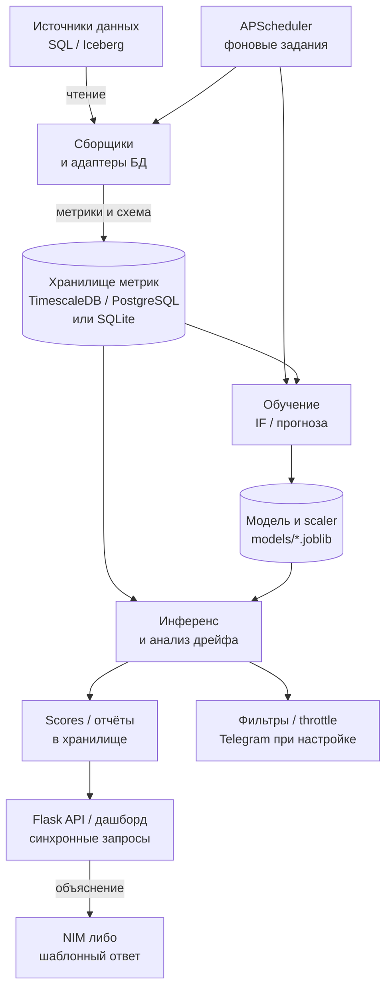

# DB Monitoring — актуальная архитектура

Срез кода: [`59c54fa`](https://github.com/aleksandr-novikov/ai-integration-development/tree/59c54fa3f5de502126cbbbf0617688e1b9ead4eb), проверка 13.10.2026. Учебная задача [#3](https://github.com/aleksandr-novikov/ai-integration-development/issues/3), В02, слайд 51: схема, компоненты, потоки и стек, около двух страниц. [Описание кейса](course/CASE.md) задаёт пользователя и измеримые цели.

## Компоненты и поток данных

Специалист по качеству данных получает сигнал об аномалии агрегированных метрик и проверяет его вручную. Система не исправляет исходные данные. Это **модульный монолит**: Flask, сборщики, планировщик и ML работают в одном приложении; отдельные контейнеры БД не превращают его в набор микросервисов.

Схема показывает основной путь сохранённых результатов. Прогноз вызывается из API синхронно; возможное обучение внутри инференса описано ниже. Планировщик, сборщики, ML и Flask находятся в одном процессе приложения.

**Сбор и хранение.** `MetricsCollector` читает число строк, размер, NULL-статистику и распределения; `SchemaCollector` фиксирует схему. `collect_for_connection` выбирает адаптер и настройки подключения, записывает данные с `project_id`. Это периодический **micro-batch**, а не непрерывный поток событий: интервал подключения 5–1440 минут, legacy-сбор по умолчанию раз в 15 минут. Полный сбор SQL-статистик может сканировать таблицу; ограничения нагрузки и режимы `sample`/`approx` зависят от адаптера. Iceberg использует метаданные snapshot/manifest.

Источник `DATABASE_URL` и хранилище `MONITOR_DB_URL` разделены. Compose запускает PostgreSQL-источник и TimescaleDB-хранилище с отдельными volumes. В TimescaleDB таблица `metrics` становится hypertable; поддержан обычный PostgreSQL без расширения. SQLite остаётся локальным режимом и используется в тестах. Хранилище содержит также пользователей, проекты, подключения, результаты ML и уведомления. Распределения могут включать значения колонок: считать всё содержимое исключительно обезличенными счётчиками нельзя.

**Обучение и инференс.** Isolation Forest получает `row_count`, среднюю долю NULL и две разности соседних согласованных наблюдений; `StandardScaler` обучается вместе с моделью. Нужны минимум 200 строк признаков. Обучение пишет модель и scaler в `models/`, скоринг читает их и сохраняет оценки. Планировщик переобучает прогноз в 03:00, IF в 04:00; часовой поиск change-point — отдельное задание. Часовой пояс берётся из окружения APScheduler, UTC явно не закреплён. Это независимые задания, без гарантии завершения одного перед другим.

Разделение обучения и инференса пока логическое: `score_table` обучает отсутствующую модель; `forecast` переобучает устаревшую прямо в HTTP-запросе. `/api/anomalies/<table>` читает сохранённые scores. В поконнектном сборе оперативный скоринг аномалий связан с настройкой Telegram; без неё эта ветка пропускается, ночное обучение/скоринг остаются. Учебные [MLflow-эксперименты](course/experiments/README.md) выполняются отдельно и **не публикуют автоматически** выбранную модель в приложение — это работа #5/#12.

**Синхронные запросы и уведомления.** Flask обслуживает API и страницы, Plotly отображает историю. Вспомогательные `/api/tables` и `/api/schema/<table>` обращаются к адаптеру источника, поэтому API не полностью изолирован от БД. Telegram использует настройки проекта, фильтры качества и ограничение частоты. LLM только формулирует гипотезу по контексту метрик; при отсутствии ключа или сбое NIM работает шаблонный ответ. Решение об аномалии принимает classical ML, причина требует проверки человеком.

## Стек, изоляция и актуальные ограничения

Python, Flask, SQLAlchemy и APScheduler позволяют переиспользовать рабочие UI, доступ к БД и фоновые задания. Scikit-learn подходит для числовых признаков без готовых обучающих меток; Prophet/линейная модель — для прогноза, ruptures и PSI/KS — для смены режима и дрейфа. Jinja2/Plotly сохраняют единый интерфейс, MLflow фиксирует учебные эксперименты. [ADR-001](adr/001-flask-and-inference-service.md) обосновывает сохранение Flask и запланированный небольшой FastAPI-сервис по требованию курса.

Flask-Login, CSRF, роли участников и проверка текущего проекта уже реализованы. Метрики, scores и ML-артефакты разделены по `project_id`; legacy сохраняет прежние пути файлов. Однако у API остаётся anonymous/legacy-режим, а кэш LLM-объяснений не содержит `project_id` и проверяется до доступа к таблице. Полной изоляции всего API пока нет: закрыть эти пробелы нужно в #4/#12/#18. Совпадающие имена таблиц разных подключений внутри одного проекта также требуют отдельной проверки идентичности источника.

| Утверждение старого Sprint 2 | Фактический статус |
|---|---|
| TimescaleDB, авторизация и уведомления только планируются | Уже реализованы; Compose использует TimescaleDB |
| Forecast не учитывает смену режима | Инвалидация по change-point, привязка к последнему значению, обработка резкого падения, неотрицательные значения и упорядоченные границы уже есть |
| Одинарное развёртывание и ограничения нагрузки | Сохраняются: scheduler внутри процесса; несколько workers могут дублировать задания. Очереди, HA и отдельного inference-сервиса пока нет |
| Заявленные latency и простой чистый Docker-запуск | Не считаются подтверждёнными замерами курса; проверяются в #12/#13. Сейчас Dockerfile не копирует включённый `requirements-course.txt` перед установкой зависимостей |

`/healthz`, `/metrics`, структурированные логи и опциональный Sentry уже существуют. Они не доказывают качество модели: в [экспериментах](course/experiments/RESULTS.md) FPR 13,27% превышает цель 10%. Протокол сверки кода и проверок — [architecture-review.md](course/architecture-review.md). Прежняя большая справка сохранена [в истории Sprint 2](https://github.com/aleksandr-novikov/ai-integration-development/blob/59c54fa3f5de502126cbbbf0617688e1b9ead4eb/docs/Architecture.md); её примеры не являются текущим контрактом API.
