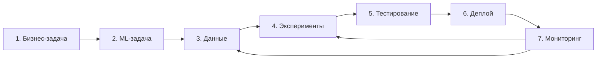

# Жизненный цикл ИИ-системы обнаружения аномалий в DB Monitoring

Цель — раньше обнаруживать нарушения качества данных. Для специалиста по качеству и эксплуатации данных Isolation Forest выдаёт сигнал для ручной проверки, без исправления БД ([кейс][case]).

**Унаследовано:** сбор/хранение, [планировщик][scheduler], [StandardScaler + Isolation Forest][detector], Flask API/интерфейс и Docker. **Курс, 23.10.2026:** «есть» — подтверждённый результат, «план» — будущая работа ([ROADMAP][roadmap]). Роли функциональные.

| Этап и ответственная роль | Вход | Действие в DB Monitoring | Результат |
|---|---|---|---|
| **1. Бизнес-задача** Бизнес-заказчик | Поздно замеченные скачки объёма и NULL | Определить пользователя, полезный сигнал и границы расследования | **Есть:** постановка задачи в [CASE][case] |
| **2. ML-задача и критерии** Аналитик | Бизнес-цель, определения инцидента и сигнала | Сформулировать детекцию аномалий без учителя и измеримый успех | **Есть:** [цели][case] — ≥80% инцидентов, FPR ≤10%, медиана задержки резких событий ≤1 цикл |
| **3. Сбор и подготовка данных** ML Engineer | Снимки метрик таблиц, синтетические инциденты | [Собрать метрики][collector], [сохранить историю][storage], совместить временные точки и вычислить дельты | **Унаследовано:** `row_count`, средняя по колонкам `null_rate`, `d_row_count`, `d_null_rate`. **Есть в курсе:** [train/validation/test с разметкой][data] и [валидация][validation] |
| **4. Эксперименты и обучение** Data Scientist | Проверенные данные, варианты параметров | Обучить scaler и IF на train, сравнить на validation; выбранный вариант оценить на test | **Есть:** [серия MLflow][experiments] и кандидат модели; автоматической публикации в приложение нет |
| **5. Тестирование и валидация** ML Engineer | Кандидат, независимые окна, цели CASE | Проверить границы, инциденты, шум и пропуски; сопоставить качество с целями | **Есть:** [тесты][tests] и [отчёт][quality]; FPR 13,27% > 10%, допуска нет. **План:** стратегия тестов ([#11][issue11]) |
| **6. Развёртывание** AI/MLOps Engineer | Кандидат после допуска, версия, контракт | Сейчас [Flask API][api] читает сохранённые scores. Для учебного выпуска связать версии и проверить запуск/откат | **План:** FastAPI ([#12][issue12]), версии и выпуск по [ADR-001][adr] и [ROADMAP][roadmap] |
| **7. Мониторинг и сопровождение** AI/MLOps Engineer | Новые метрики, сигналы, ошибки, подтверждения специалиста | Раздельно наблюдать [PSI/KS данных БД][drift], [технику приложения][instrumentation] и качество детектора | **Унаследовано:** мониторинг БД/приложения, ночное обучение. **План:** мониторинг входов/качества ML и стратегия переобучения ([#16][issue16]/[#17][issue17]) |

Возвраты 7 → 3 и 7 → 4 — **план** #16/#17: уточнить данные/разметку, исследовать ухудшение, обучить кандидата и повторить этап 5. Ночное обучение, PSI/KS и технические метрики сами по себе не подтверждают качество ML.

Источники: **В01, Анна Арзамасова** — этапы (26–32), обратная связь (33, 50), роли (16–20, 52), конкретизация продукта (51), риски практики (53–56), домашнее задание — описание 7 этапов и схема на 1 странице (62); критерии приёмки — [Issue #2][issue].

[case]: CASE.md
[scheduler]: ../../collectors/scheduler.py
[detector]: ../../ml/anomaly_detector.py
[roadmap]: ROADMAP.md
[collector]: ../../collectors/metrics_collector.py
[storage]: ../../app/metrics_storage.py
[data]: DATASET.md
[validation]: validation/README.md
[experiments]: experiments/RESULTS.md
[tests]: ../../tests/test_model_quality.py
[quality]: quality/README.md
[api]: ../../app/api.py
[adr]: ../adr/001-flask-and-inference-service.md
[drift]: ../../ml/drift.py
[instrumentation]: ../../app/instrumentation.py
[issue]: https://github.com/aleksandr-novikov/ai-integration-development/issues/2
[issue11]: https://github.com/aleksandr-novikov/ai-integration-development/issues/11
[issue12]: https://github.com/aleksandr-novikov/ai-integration-development/issues/12
[issue16]: https://github.com/aleksandr-novikov/ai-integration-development/issues/16
[issue17]: https://github.com/aleksandr-novikov/ai-integration-development/issues/17
