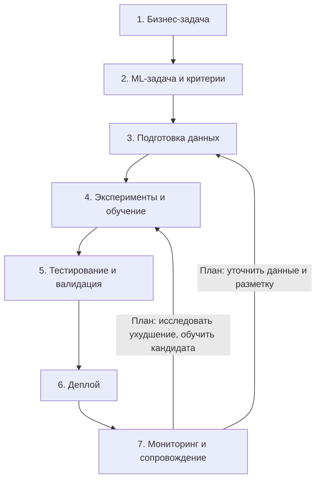

# Жизненный цикл ИИ-системы обнаружения аномалий в DB Monitoring

Цель — раньше обнаруживать нарушения качества данных; пользователь — специалист по качеству и эксплуатации данных. Isolation Forest выдаёт сигнал для ручной проверки, без автоматического исправления БД ([кейс](CASE.md)). Сбор, хранение, детектор, Flask API/интерфейс и Docker унаследованы от DB Monitoring; их наличие не означает выполнения заданий курса ([архитектура](../Architecture.md)).

Срез на **23.10.2026**: «курс: есть» обозначает подготовленный учебный результат, «план» — ожидаемый результат открытой задачи. Статусы проверены в GitHub; номера и зависимости — в [ROADMAP](ROADMAP.md). Роли ниже функциональные, а не персональное распределение работы.

| Этап | Вход | Действие в DB Monitoring | Результат и состояние | Основная роль |
|---|---|---|---|---|
| **1. Постановка бизнес-задачи** | Потребность замечать скачки объёма и доли NULL | Определить пользователя, проблему и границы ручного расследования | **Курс: есть** [CASE](CASE.md), задача [#1](https://github.com/aleksandr-novikov/ai-integration-development/issues/1) закрыта | Бизнес-заказчик |
| **2. Формализация ML-задачи и критериев успеха** | Бизнес-цель, история метрик, определения инцидента и сигнала | Детекция без учителя: `score = decision_function`, `score < 0` — сигнал; оценка на более позднем размеченном периоде | **Курс: есть** [цели CASE](CASE.md): обнаружить ≥80% инцидентов, FPR ≤10%, медиана задержки резких событий ≤1 цикл. Фактическая проверка целей — этап 5 | Аналитик |
| **3. Сбор и подготовка данных** | Снимки метрик таблиц; для оценки — синтетические инциденты | [Коллектор](../../collectors/metrics_collector.py) собирает метрики; [хранилище](../../app/metrics_storage.py) сохраняет историю; [scheduler](../../collectors/scheduler.py) запускает периодические задания. [Подготовка признаков](../../ml/anomaly_detector.py) совмещает timestamps и считает разности соседних доступных точек | **Унаследовано:** `row_count`, средняя по колонкам `null_rate`, `d_row_count`, `d_null_rate`. **Курс: есть** [датасет](DATASET.md) с разметкой и train/validation/test ([#7](https://github.com/aleksandr-novikov/ai-integration-development/issues/7)), [валидация](validation/README.md) ([#8](https://github.com/aleksandr-novikov/ai-integration-development/issues/8)); обе задачи закрыты | ML Engineer |
| **4. Эксперименты и обучение модели** | Проверенные данные, четыре признака, варианты параметров | Обучить StandardScaler и Isolation Forest на train; выбрать параметры на validation, затем оценить выбранную модель на test | **Унаследовано:** [обучение и joblib](../../ml/anomaly_detector.py). **Курс: есть** [серия MLflow](experiments/RESULTS.md), [#9](https://github.com/aleksandr-novikov/ai-integration-development/issues/9) закрыта; автоматической публикации модели в приложение нет | Data Scientist |
| **5. Тестирование и валидация** | Кандидат модели, независимые окна, критерии CASE | Проверить короткую историю, стабильный ряд, инциденты, шум и пропуски; сопоставить качество с целями | **Унаследовано:** [тесты детектора](../../tests/test_anomaly_detector.py). **Курс: есть** [поведенческие тесты](../../tests/test_model_quality.py) и [отчёт качества](quality/README.md) ([#10](https://github.com/aleksandr-novikov/ai-integration-development/issues/10) закрыта); baseline не проходит цель FPR. **План:** тестовая стратегия [#11](https://github.com/aleksandr-novikov/ai-integration-development/issues/11) | ML Engineer |
| **6. Развёртывание модели** | Модель/scaler, результаты проверки, контракт и версия | В текущем контуре фоновый скоринг сохраняет оценки, [Flask API аномалий](../../app/api.py) читает их. Для учебного выпуска связать версии и проверить запуск/откат | **Унаследовано:** Flask-контур. **План:** версии [#5](https://github.com/aleksandr-novikov/ai-integration-development/issues/5), FastAPI [#12](https://github.com/aleksandr-novikov/ai-integration-development/issues/12), запуск [#13](https://github.com/aleksandr-novikov/ai-integration-development/issues/13), стратегия деплоя [#14](https://github.com/aleksandr-novikov/ai-integration-development/issues/14) по [ADR-001](../adr/001-flask-and-inference-service.md). Текущая baseline не получила положительного допуска по качеству | AI/MLOps Engineer |
| **7. Мониторинг и сопровождение** | Новые метрики, технические ошибки, сигналы и подтверждения специалиста | Раздельно наблюдать данные контролируемых БД, приложение и качество детектора; по ухудшению уточнять данные и повторять эксперименты | **Унаследовано:** продуктовый [PSI/KS](../../ml/drift.py), технические [HTTP/collector-метрики](../../app/instrumentation.py), ночное [переобучение](../../collectors/scheduler.py). **План:** технический мониторинг курса [#15](https://github.com/aleksandr-novikov/ai-integration-development/issues/15), мониторинг входов/качества модели [#16](https://github.com/aleksandr-novikov/ai-integration-development/issues/16), стратегия дрейфа и проверяемого переобучения [#17](https://github.com/aleksandr-novikov/ai-integration-development/issues/17) | AI/MLOps Engineer |

Обратные переходы — план работ #16/#17 с повторной проверкой кандидата на этапе 5; существующее ночное обучение само по себе не реализует этот процесс. PSI/KS по колонкам БД и технические метрики приложения не доказывают качество ML-модели.

Основание: [Issue #2](https://github.com/aleksandr-novikov/ai-integration-development/issues/2), ссылающийся на В01, слайд 62. Презентация В01 локально недоступна; названия семи этапов взяты из постановки задачи, требования — из Issue.
